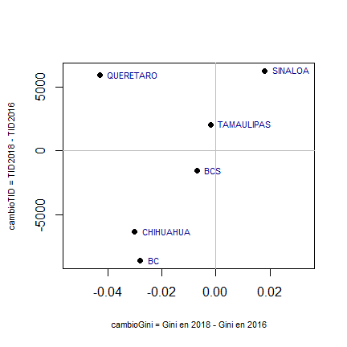
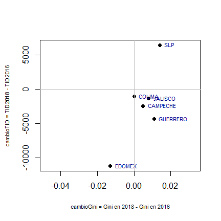

Prueba sobre la asociación entre la desigualdad económica y la
incidencia delictiva en México usando Estadística No Paramétrica
================
José Andrés Germán Parra
10-07-2023


# 1 RESUMEN

En este proyecto se abordó el tema de la desigualdad económica y su
posible relacion con la incidencia del crimen en algunos estados de
México en dos años diferentes. Se tomaron las variables medidas en dos
años, se trabajó de forma separada con territorios donde creció la
desigualdad y aquellos donde decreció, y se estudió la variable que mide
la actividad delictiva. Algunos especialistas afirman que hay una
relación positiva entre las dos variables, y en el par de hipótesis esta
es la hipótesis alternativa. Dado que el tamaño de muestra era pequeño y
que no se tiene certeza sobre la distribución de los datos, lo más
pertinente fue utilizar estadística no paramétrica.

**Palabras** **clave**: Desigualdad económica, coeficiente de Gini, tasa
de incidencia delictiva, diferencia de medias, prueba de hipótesis, U de
Mann-Whitney, gobernador, estados de la república.

# 2 INTRODUCCIÓN

La desigualdad económica se define como la distribución dispar de los
ingresos y bienes dentro de una sociedad, en especial el salario que se
le da a los trabajadores, las pensiones, subsidios de desempleo. La
distribución de la riqueza hace a una parte de la población tener
sentimiento de impotencia o enojo. Según el INEGI, en México, en el
2012, el 1% más rico del país capturaba 17% del ingreso del país, y el
10% más rico tenía el 50.2% del ingreso nacional.

Según la página del banco mundial, se ha encontrado que en Latinoamérica
no afecta en los índices de criminalidad el número de personas pobres,
pero si los ricos se vuelven más ricos ésto causa un descontento social,
lo que se podría asociar con una mayor incidencia delictiva. Aunque,
como lo menciona Luis Herrera-Laso M., otras variables podrían afectar
en mayor o menor grado la presencia del crimen, tales como la
infraestructura física precaria, la violencia intrafamiliar, la
presencia de pandillas juveniles, el crimen organizado, la presencia de
armas y drogas, el ambiente de impunidad y procuración de justicia
precaria, y los bajos niveles de organización y cohesión social.

Una de las formas en que se mide la desigualdad económica es utilizando
el coeficiente de Gini, el cual se encuentra entre 0 y 1, donde 0
corresponde a la igualdad económica deseable por la mayoría, es decir,
que todos tengan los mismos ingresos, y 1 corresponde al peor escenario
de desigualdad.

En este trabajo se utilizan los datos de dos años, de cada estado de
México se obtuvieron: el coefiente de Gini y la tasa de incidencia
delictiva por cada 100 mil habitantes.

Cada estado tiene a cargo la seguridad pública, como función encargada
en el artículo 21 de la Constitución política de la nación, lo que hagan
o dejen de hacer las autoridades afecta en la incidencia delictiva.

# 3 JUSTIFICACIÓN

En este proyecto se utiliza como herramienta lo aprendido en el curso de
Estadística No Paramétrica, en particular la prueba de medias para
muestras independientes (no pareadas), y se utilizan las medidas de
asociación. Los tamaños de muestra son pequeños, y la distribución de
las tasas antes mencionadas no es conocida, y encontrar la
transformación adecuada sobre éstas es un trabajo extra. Es plausible y
necesario utilizar métodos no paramétricos dadas las condiciones
mencionadas.

# 4 OBJETIVOS

Se pretende determinar si existe una asociación entre el crecimiento
desigualdad económica y el incremento de la actividad delictiva en el
país, donde se debe tomar en cuenta que las instancias de gobierno
también tienen un efecto sobre el nivel de crimen que se comete.

# 5 MATERIALES Y MÉTODOS

## 5.1 DATOS

El coeficiente de Gini, para cada estado de la república, medido los
años 2016 y 2018, se encuentra en un anexo de Wikipedia que recopiló
estas medidas en los *informes de pobreza y evaluación* del 2020. Y en
la página del INEGI se capturaron los datos sobre las tasas de
incidencia delictiva, la cual es el cociente del número total de delitos
ocurridos entre la población mayor de edad multiplicado por 100000
habitantes. Cabe recalcar que se consideran todos los tipos de delitos.

## 5.2 VARIABLES QUE INFLUYEN EN EL ANÁLISIS

En México cada estado tiene a su gobernador, y las elecciones de los 32
gobernadores no se hacen en el mismo año. Por ajustes, algunos mandatos
duran más que otros, por lo que entre el 2016 y 2018 se pueden tener
hasta dos mandatarios diferentes, aunque a veces se tienen interinatos.
Y como ya se mencionó en la introducción, los gobernadores tienen la
responsabilidad sobre la seguridad del territorio que tienen a cargo. El
partido político del gobernador también podría tener influencia sobre lo
que éste haga con respecto a la seguridad.

Se comparan las tasas delictivas de estados que están gobernados por
sujetos provenientes del mismo partido político, además, entre el 2016 y
2018 se debió tener al mismo sujeto gobernando, lo que permite que el
análisis sobre la posible asociación de los delitos con la desigualdad
económica sea válido. Los datos se presentan en la Tabla 5.3, donde
*Gini2016* es el coeficiente medido en el 2016, *TID2016* es la tasa de
incidencia delictiva en 2016, *Gini2018* y *TID2018* son esas mismas
variables pero para el 2018. En las otras columnas se dan el número de
gobernadores y su(s) partido(s) político(s).

``` r
> # Construcción del conjunto de datos con las fuentes mencionadas
> gini2018 = c(0.432, 0.402, 0.432, 0.472,  0.414, 0.423, 0.487, 0.443, 0.532, 
+              0.419, 0.416, 0.482, 0.423, 0.430, 0.401, 0.424, 0.429, 0.437, 
+              0.435, 0.496, 0.407, 0.437, 0.414, 0.464, 0.446, 0.439, 0.447,
+              0.472, 0.373, 0.453, 0.456,  0.419)
> 
> gini2016 = c(0.416, 0.430, 0.439, 0.467, 0.417, 0.423, 0.508, 0.473, 0.507,   0.415, 
+              0.576, 0.471, 0.430, 0.422, 0.414, 0.424, 0.437, 0.472, 0.578, 0.493, 
+              0.439, 0.480 ,0.435, 0.450, 0.428, 0.498, 0.459, 0.474, 0.378, 0.489, 
+              0.452, 0.491)
> 
> TID2018 = c(36500, 42725, 28377, 26466, 24813, 28376, 19409, 28622, 69716, 22586, 38067,
+           43051, 25987, 40543, 51520, 22999, 45312, 23670, 27805, 26221, 37647, 32756,
+           33243, 32342, 29507, 50861, 36546, 25368, 40336, 25350, 26462, 26670)
> 
> TID2016 = c(41254, 51286, 29939, 28892, 25215, 29449, 20055, 34920, 49913, 23283, 33384, 
+             47392, 23564, 41874, 62751, 26366, 43749, 26260, 32819, 27897, 31331,
+             26860, 32862, 25867, 23257, 42624, 31664, 23318, 27707, 19892, 23736,
+             24160)  
> 
> nombs = c("AGS", "BC", "BCS", "CAMPECHE", "COAHUILA", "COLIMA", "CHIAPAS",
+           "CHIHUAHUA", "CDMX", "DURANGO", "GUANAJUATO", "GUERRERO", "HIDALGO",
+           "JALISCO", "EDOMEX", "MICHOACAN", "MORELOS", "NAYARIT", "NL", "OAXACA", 
+           "PUEBLA", "QUERETARO", "QR", "SLP", "SINALOA", "SONORA", "TABASCO",
+           "TAMAULIPAS", "TLAXCALA", "VERACRUZ", "YUCATAN", "ZACATECAS")
> 
> partpol = c("PRI y PAN", "PAN", "PAN", "PRI", "PRI", "PRI", "PV", "PAN", "PRD", 
+             "PRI y PAN", "PAN", "PRI", "PRI", "PRI", "PRI", "PRD", "PRD y PES", 
+             "PAN-PRD-PT", "Indep.", "MC y PRI", "PAN", "PAN", "PRI y PRD", "PRI", 
+             "PAN", "PRI", "PRD-PT-MC", "PAN", "PRI", "PRI y PAN y MOR",
+             "PRI y PAN", "PRI")
> names(TID2018) = nombs
> names(TID2016) = nombs
> names(gini2018) = nombs
> names(gini2016) = nombs
> ngobs = c(2, 1, 1, 1, 2, 1, 1, 1, 2, 2, 2, 1, 2, 1, 1, 1, 2, 2, 1, 2, 2, 1, 2,
+           1, 1, 1, 1, 1, 2, 3, 2, 2) 
```

## 5.3 ¿CÓMO SE UTILIZAN LOS DATOS?

En cada entidad se puede ver si el coeficiente de Gini se incrementó o
decreció, es decir, si hay una mayor disparidad económica. Se define una
muestra aleatoria para los estados donde el coeficiente de Gini bajó y
otra donde ocurrió lo contrario

$$\begin{align*}
X_1&=TID2018^+_1 - TID16^+_1,\ldots,X_m=TID2018^+_m - TID16^+_m \overset{iid}{\sim} F_X \\
Y_1&=TID2018^-_1 - TID16^-_1,\ldots,Y_n=TID2018^-_n - TID16^-_n \overset{iid}{\sim} F_Y
\end{align*}$$

$TID18^+_i$ y $TID16^+_i$ son las tasas de los estados donde se
incrementó la desigualdad; al contrario, si el superíndice es $^{-}$
denota variables medidas donde Gini decreció.

## 5.4 PRUEBA DE HIPÓTESIS

Se quiere probar que en los estados donde bajó la desigualdad también
bajó la incidencia de delitos, esto se refleja en las diferencias de las
tasas de 2018 con las de 2016 (las $Y_i$), las cuales serían mayormente
negativas. Al mismo tiempo, donde se incrementó el coeficiente de Gini
las diferencias de las $X_i$ deberían ser mayormenre positivas.
Estadísticamente hablando, tenemos que $Y \overset{st}{<} X$. Las
hipótesis son

$$H_0: F_X(t)=F_Y(t)  ~~\text{contra}~~ Ha: F_X(t) < F_Y(t).$$

### 5.4.1 Estados gobernados por el PAN

Para estos dos años tenemos información suficiente para hacer el
análisis por separado con dos partidos políticos, el PAN y el PRI. Por
el momento solo se analizan datos donde gobernaron individuos del PAN y
se trató de la misma persona en ambos años. Observando la Tabla 5.3,
notamos se podrán usar datos de Baja California, Baja California Sur,
Chihuahua, Querétaro, Sinaloa y Tamaulipas. Los cambios en las dos
variables se muestran de forma gráfica en la Figura 5.1.

``` r
> eds_elegs = c("BC", "BCS", "CHIHUAHUA", "QUERETARO", "SINALOA", "TAMAULIPAS") 
> cambioGini = gini2018[eds_elegs] - gini2016[eds_elegs]
> cambioTID = TID2018[eds_elegs] - TID2016[eds_elegs]
> plot(cambioGini, cambioTID, pch = 19, xlim = c(min(cambioGini)-0.01, max(cambioGini)+0.015), 
+      xlab = "cambioGini = Gini en 2018 - Gini en 2016",
+      ylab = "cambioTID = TID2018 - TID2016", cex.lab = 0.8,
+      cex.lab = 0.7)
> text(cambioGini, cambioTID, labels = eds_elegs, col='darkblue', pos=4, cex=0.7)
> abline(h = 0, v = 0, col = 'gray')
```

<div class="figure">



<p class="caption">

<span id="fig:unnamed-chunk-2"></span>Figure 5.1: Diferencias entre los
coeficientes de Gini y las TID por estado (únicamente con gobiernos del
PAN)

</p>

</div>

Solo el estado de Sinaloa presentó un aumento de la desigualdad, por lo
que $m=1$ y $n = 5$. Las diferencias de ambos indicadores se presentan
en la Tabla 5.4. Se tienen las seis observaciones siguientes

$$y_1= -8561,~ y_2= -1562,~ y_3=-6298 ,~ y_4=5896 ,~ y_5= 2050 , ~ x_1 = 6250.$$

Ahora, se utiliza una prueba aleatorizada porque el estadístico $U$ de
Mann-Whitney es variable aleatoria discreta, cuyo rango en este caso es
$R_{U}=\{0,~1,...,~5\}$. Las probabilidades exactas bajo la hipótesis
nula se muestran en la Tabla 5.1.

``` r
> dU = dwilcox(0:5, m = 1, n = 5)
> PsBajoH0 = cbind(0L:5L, round(dU, 5))
> colnames(PsBajoH0) = c("$u$", "$P(U = u \\mid H_0)$")
> kable(PsBajoH0,  
+       caption= "Probabilidades de U (estadístico de Mann-Whitney) exactas
+       bajo la hipótesis nula con $m = 1$ y $n = 5$")
```

| $u$ | $P(U = u \mid H_0)$ |
|----:|--------------------:|
|   0 |             0.16667 |
|   1 |             0.16667 |
|   2 |             0.16667 |
|   3 |             0.16667 |
|   4 |             0.16667 |
|   5 |             0.16667 |

<span id="tab:unnamed-chunk-3"></span>Table 5.1: Probabilidades de U
(estadístico de Mann-Whitney) exactas bajo la hipótesis nula con $m = 1$
y $n = 5$

Para esta prueba que se quiere hacer con un nivel de significancia
$\alpha = 0.05$,

$$\mathbb{P} (U > 5|H_0) + p\mathbb{P} (4 < U \leq 5|H_0) = 0.05$$
$$\Rightarrow 0 + p(0.167) = 0.05$$
$$\Rightarrow  p = \frac{0.05}{0.167} = 0.299$$

la prueba aleatorizada es rechazar la hipótesis nula si $U=5$ con
probabilidad 0.299, y de otra forma no se rechaza. Todos los $y_i$ son
menores que $x_1$, así que el valor del estadístico es
$u=\sum_{i=1}^m\sum_{j= 1}^n I_{(-\infty,~ x_i)}(y_j)=5$, por lo que se
debe decidir si se rechaza $H_0$ con una realización de una Bernoulli
que tiene $p=0.299$.

``` r
> difdels_gini.inc = cambioTID["SINALOA"]
> difdels_gini.dec = cambioTID[ eds_elegs[!(eds_elegs %in% "SINALOA")] ]
> x = difdels_gini.inc
> y = difdels_gini.dec
> u = sum(outer(y, x, "<")); cat(paste("u = ", u))
```

    u =  5

``` r
> if (u == 5) {
+   cat("Se hace una extracción de X ~ Bernoulli(0.299) para \n decidir si se rechaza H_0 porque u = 5. ") 
+   set.seed(8628); extr_Bern = rbinom(1, 1, 0.299)
+   textoResultExt = paste("x = ", extr_Bern, " => ")
+   if(extr_Bern == 1){ cat(paste(textoResultExt, "Rechazar H_0.")) }
+   else {cat(paste(textoResultExt,"No rechazar H_0."))} 
+ } else {
+   cat("No rechazar H_0.")
+ }
```

    Se hace una extracción de X ~ Bernoulli(0.299) para 
     decidir si se rechaza H_0 porque u = 5. x =  0  =>  No rechazar H_0.

Tras la extracción de una Bernoulli con R, se decide no rechazar la
hipótesis nula de que $F_X(x)=F_Y(x)$, es decir, no hay evidencia
suficiente para rechazar que la TID es igual en donde crece y decrece la
desigualdad.

Ahora, se utiliza una medida de asociación, el coeficiente $\tau$ de
Kendall. El estadístico $T$ se calcula con los cambios del coeficiente
de Gini y los de la tasa de incidencia delictiva en los dos años, luego
las hipótesis son

$$H_0: \tau = 0 ~~\text{contra}~~ H_a: \tau > 0$$

es decir, bajo la nula no se asocian la desigualdad económica y la
presencia del crimen en estos dos años, y con la alternativa se
establece que hay una relación positiva entre las dos variables. La
prueba de hipótesis se hace a continuación.

``` r
> cor.test(cambioGini, cambioTID, method = "kendall", alternative = "greater", continuity =TRUE)
```

        Kendall's rank correlation tau

    data:  cambioGini and cambioTID
    T = 10, p-value = 0.2347
    alternative hypothesis: true tau is greater than 0
    sample estimates:
          tau 
    0.3333333 

El valor p es mayor que 0.05, por lo que nuevamente no se rechaza que no
existe una asociación entre la desigualdad económica y la tasa
delictiva.

### 5.4.2 Estados gobernados por el PRI

Ahora, se trabaja con datos donde gobernó la misma persona del PRI en
ambos años, los estados son: Campeche, Colima, Guerrero, Jalisco, Estado
de México (EDOMEX), San Luis Potosí (SLP). El gráfico de dispersión con
los cambios de los coeficiente de Gini y los cambios de las tasas de
incidencia delictiva se presenta en la Figura 5.2.

``` r
> eds_elegs = c("CAMPECHE", "COLIMA", "GUERRERO", "JALISCO", "EDOMEX", "SLP") 
> cambioGini.PRI = gini2018[eds_elegs] - gini2016[eds_elegs]
> cambioTID.PRI = TID2018[eds_elegs] - TID2016[eds_elegs]
> plot(cambioGini.PRI, cambioTID.PRI, pch = 19, xlim = c(min(cambioGini)-0.005, max(cambioGini)+0.015), 
+      xlab = "cambioGini = Gini en 2018 - Gini en 2016",
+      ylab = "cambioTID = TID2018 - TID2016", cex.lab = 0.8,
+      cex.lab = 0.7)
> text(cambioGini.PRI, cambioTID.PRI, labels = eds_elegs, col='darkblue', pos=4, cex=0.7)
> abline(h = 0, v = 0, col = 'gray')
```

<div class="figure">



<p class="caption">

<span id="fig:unnamed-chunk-6"></span>Figure 5.2: Diferencias calculadas
entre los coeficientes de Gini y las TID (únicamente con gobiernos del
PRI)

</p>

</div>

Solo el Estado de México presentó un decrecimiento de esta desigualdad y
en Colima no cambió el coeficiente de Gini, no puede utilizarse esa
observación. Las diferencias de ambos indicadores se presentan en la
Tabla 5.5. Los datos que se tienen son

$$x_1= -2426,~ x_2=-4341,~ x_3=-1331,~ x_4=6475, y_1 = -11231,$$

por lo que $m=4$ y $n = 1$. Utilizamos una prueba aleatorizada ya que el
estadístico $U$ en este caso tiene rango $R_U=\{0,~1,...,~4\}$, y las
probabilidades exactas bajo la hipótesis nula se muestran en la Tabla
5.2.

``` r
> dU = dwilcox(0:4, m = 4, n = 1)
> PsBajoH0 = cbind(0L:4L, round(dU, 3))
> colnames(PsBajoH0) = c("$u$", "$P(U = u \\mid H_0)$")
> kable(PsBajoH0,  
+       caption= "Probabilidades de U (estadístico de Mann-Whitney) exactas
+       bajo la hipótesis nula con $m = 4$ y $n = 1$")
```

| $u$ | $P(U = u \mid H_0)$ |
|----:|--------------------:|
|   0 |                 0.2 |
|   1 |                 0.2 |
|   2 |                 0.2 |
|   3 |                 0.2 |
|   4 |                 0.2 |

<span id="tab:unnamed-chunk-7"></span>Table 5.2: Probabilidades de U
(estadístico de Mann-Whitney) exactas bajo la hipótesis nula con $m = 4$
y $n = 1$

Para esta prueba que se quiere hacer con un nivel de significancia
$\alpha = 0.05$,

$$\mathbb{P} (U > 4|H_0) + p\mathbb{P} (3 < U \leq 4|H_0) = 0.05$$
$$\Rightarrow 0 + p(0.2) = 0.05$$
$$\Rightarrow  p = \frac{0.05}{0.2} = 0.25$$

la prueba aleatorizada es rechazar con probabilidad 0.25 esta hipótesis
nula si $U=4$, y de otra forma no rechazar. $y_1$ es menor que las
cuatro observaciones de la otra población, así el valor del estadístico
con estos datos es
$u=\sum_{i=1}^m\sum_{j= 1}^n I_{(-\infty,~ x_i)}(y_j)=4$,

``` r
> difdels_gini.inc = cambioTID.PRI[eds_elegs[!(eds_elegs %in% c("EDOMEX", "COLIMA"))]]
> difdels_gini.dec = cambioTID.PRI["EDOMEX"]
> x = difdels_gini.inc
> y = difdels_gini.dec
> u = sum(outer(y, x, "<"))
> if (u == 4) {
+   cat("Se hace una extracción de X ~ Bernoulli(0.25) para \n decidir si se rechaza H_0 porque u = 4. ") 
+   set.seed(2774); extr_Bern = rbinom(1, 1, 0.25)
+   textoResultExt = paste("x =", extr_Bern, " => ")
+   if(extr_Bern == 1){ cat(paste(textoResultExt, "Rechazar H_0.")) }
+   else {cat(paste(textoResultExt,"No rechazar H_0."))} 
+ } else {
+   cat("No rechazar H_0.")
+ }
```

    Se hace una extracción de X ~ Bernoulli(0.25) para 
     decidir si se rechaza H_0 porque u = 4. x = 0  =>  No rechazar H_0.

por lo que no se rechaza la hipótesis nula de que $F_X(x)=F_Y(x)$.

Ahora, se utiliza el una medida de asociación, el coeficiente $\tau$ de
Kendall. El estadístico $T$ se calcula con los cambios del coeficiente
de Gini y los de la tasa de incidencia delictiva en los dos años, luego
las hipótesis son

$$H_0: \tau = 0 ~~vs.~~ H_a: \tau > 0$$

es decir, bajo la nula no se asocian la desigualdad económica y la
presencia del crimen en estos dos años, y con la alternativa se
establece que hay una relación positiva entre las dos variables. Y el la
prueba de hipótesis se hace a continuación

``` r
> cor.test(cambioGini.PRI , cambioTID.PRI , method = "kendall", alternative = "greater", continuity =TRUE)
```

        Kendall's rank correlation tau

    data:  cambioGini.PRI and cambioTID.PRI
    T = 10, p-value = 0.2347
    alternative hypothesis: true tau is greater than 0
    sample estimates:
          tau 
    0.3333333 

el valor p es mayor que 0.05, por lo que no se rechaza la hipótesis
nula.

|            | Gini2016 | TID2016 | Gini2018 | TID2018 | No. de gobs. | Partido(s)      |
|------------|:---------|:--------|:---------|:--------|--------------|:----------------|
| AGS        | 0.416    | 41254   | 0.432    | 36500   | 2            | PRI y PAN       |
| BC         | 0.43     | 51286   | 0.402    | 42725   | 1            | PAN             |
| BCS        | 0.439    | 29939   | 0.432    | 28377   | 1            | PAN             |
| CAMPECHE   | 0.467    | 28892   | 0.472    | 26466   | 1            | PRI             |
| COAHUILA   | 0.417    | 25215   | 0.414    | 24813   | 2            | PRI             |
| COLIMA     | 0.423    | 29449   | 0.423    | 28376   | 1            | PRI             |
| CHIAPAS    | 0.508    | 20055   | 0.487    | 19409   | 1            | PV              |
| CHIHUAHUA  | 0.473    | 34920   | 0.443    | 28622   | 1            | PAN             |
| CDMX       | 0.507    | 49913   | 0.532    | 69716   | 2            | PRD             |
| DURANGO    | 0.415    | 23283   | 0.419    | 22586   | 2            | PRI y PAN       |
| GUANAJUATO | 0.576    | 33384   | 0.416    | 38067   | 2            | PAN             |
| GUERRERO   | 0.471    | 47392   | 0.482    | 43051   | 1            | PRI             |
| HIDALGO    | 0.43     | 23564   | 0.423    | 25987   | 2            | PRI             |
| JALISCO    | 0.422    | 41874   | 0.43     | 40543   | 1            | PRI             |
| EDOMEX     | 0.414    | 62751   | 0.401    | 51520   | 1            | PRI             |
| MICHOACAN  | 0.424    | 26366   | 0.424    | 22999   | 1            | PRD             |
| MORELOS    | 0.437    | 43749   | 0.429    | 45312   | 2            | PRD y PES       |
| NAYARIT    | 0.472    | 26260   | 0.437    | 23670   | 2            | PAN-PRD-PT      |
| NL         | 0.578    | 32819   | 0.435    | 27805   | 1            | Indep.          |
| OAXACA     | 0.493    | 27897   | 0.496    | 26221   | 2            | MC y PRI        |
| PUEBLA     | 0.439    | 31331   | 0.407    | 37647   | 2            | PAN             |
| QUERETARO  | 0.48     | 26860   | 0.437    | 32756   | 1            | PAN             |
| QR         | 0.435    | 32862   | 0.414    | 33243   | 2            | PRI y PRD       |
| SLP        | 0.45     | 25867   | 0.464    | 32342   | 1            | PRI             |
| SINALOA    | 0.428    | 23257   | 0.446    | 29507   | 1            | PAN             |
| SONORA     | 0.498    | 42624   | 0.439    | 50861   | 1            | PRI             |
| TABASCO    | 0.459    | 31664   | 0.447    | 36546   | 1            | PRD-PT-MC       |
| TAMAULIPAS | 0.474    | 23318   | 0.472    | 25368   | 1            | PAN             |
| TLAXCALA   | 0.378    | 27707   | 0.373    | 40336   | 2            | PRI             |
| VERACRUZ   | 0.489    | 19892   | 0.453    | 25350   | 3            | PRI y PAN y MOR |
| YUCATAN    | 0.452    | 23736   | 0.456    | 26462   | 2            | PRI y PAN       |
| ZACATECAS  | 0.491    | 24160   | 0.419    | 26670   | 2            | PRI             |

<span id="tab:unnamed-chunk-10"></span>Table 5.3: Coeficiente de Gini y
tasa de incidencia delictiva en 2016 y 2018 por estado, número de
personas que gobernaron y su partido político

``` r
> kable(cbind("GINI2018 - GINI2016" = round(cambioGini, 3), 
+             "TID2018 - TID2016" = cambioTID,
+             "Desigualdad Económica" = ifelse( cambioGini < 0, "Decreció",
+                                               ifelse(cambioGini > 0, "Creció", "Sin cambio"))), 
+       caption = "Diferencias de los coefientes de Gini y las TID para cada estado seleccionado al cambiar de año donde gobernó el PAN")
```

|            | GINI2018 - GINI2016 | TID2018 - TID2016 | Desigualdad Económica |
|------------|:--------------------|:------------------|:----------------------|
| BC         | -0.028              | -8561             | Decreció              |
| BCS        | -0.007              | -1562             | Decreció              |
| CHIHUAHUA  | -0.03               | -6298             | Decreció              |
| QUERETARO  | -0.043              | 5896              | Decreció              |
| SINALOA    | 0.018               | 6250              | Creció                |
| TAMAULIPAS | -0.002              | 2050              | Decreció              |

<span id="tab:unnamed-chunk-11"></span>Table 5.4: Diferencias de los
coefientes de Gini y las TID para cada estado seleccionado al cambiar de
año donde gobernó el PAN

``` r
> kable(cbind("GINI2018 - GINI2016" = round(cambioGini.PRI, 3), 
+             "TID2018 - TID2016" = cambioTID.PRI,
+             "Desigualdad Económica" = ifelse( cambioGini.PRI < 0, "Decreció", 
+                                               ifelse(cambioGini.PRI > 0, "Creció", "Sin cambio"))),
+             caption = "Diferencias de los coefientes de Gini y las TID para cada estado seleccionado al cambiar de año donde gobernó el PRI")
```

|          | GINI2018 - GINI2016 | TID2018 - TID2016 | Desigualdad Económica |
|----------|:--------------------|:------------------|:----------------------|
| CAMPECHE | 0.005               | -2426             | Creció                |
| COLIMA   | 0                   | -1073             | Sin cambio            |
| GUERRERO | 0.011               | -4341             | Creció                |
| JALISCO  | 0.008               | -1331             | Creció                |
| EDOMEX   | -0.013              | -11231            | Decreció              |
| SLP      | 0.014               | 6475              | Creció                |

<span id="tab:unnamed-chunk-12"></span>Table 5.5: Diferencias de los
coefientes de Gini y las TID para cada estado seleccionado al cambiar de
año donde gobernó el PRI

# 6 RESULTADOS

Fijando el partido político PAN para obtener los datos, y con un único
individuo gobernando su respectivo estado en el periodo del cual se
tiene interés, no se rechazó la hipótesis de que no existe una relación
entre la desigualdad económica y la incidencia delictiva en los estados.
Los mismos resultados se obtuvieron cuando se fijó el partido político
PRI y los gobernadores se mantuvieron en el periodo. Es importante
resaltar que el valor del estadístico de prueba estuvo cerca de la
región de rechazo, en ambas pruebas se decidió usando una extracción de
una Bernoulli con $p<0.3$.

# 7 CONCLUSIONES

Usando dos variables, que miden la desigualdad social y el crimen en el
país, se ha probado la hipótesis de la asociación entre estas dos
características en los estados en los años 2016 y 2018, donde no se
encontró evidencia suficiente de que haya asociación de la desigualdad
económica y la incidencia delictiva. Como recomendación, deberían
estudiarse modelos que incluyan otras variables (como las mencionadas en
la introducción) junto con la desigualdad económica.

# 8 REFERENCIAS BIBLIOGRÁFICAS

1.  Instituto Nacional de Estadística y Geografía (INEGI) (no date)
    Incidencia Delictiva, Instituto Nacional de Estadística y Geografía
    (INEGI). Disponible en: <https://www.inegi.org.mx/temas/incidencia/>
    (Accesado: 06 Julio 2023)

2.  colaboradores de Wikipedia. (s. f.). Anexo:Entidades federativas de
    México por Coeficiente de Gini - Wikipedia, la enciclopedia libre.
    <https://es.wikipedia.org/wiki/Anexo:Entidades_federativas_de_M%C3%A9xico_por_Coeficiente_de_Gini>
    (Accesado: 06 Julio 2023)

3.  Mundial, B. (2014). “Está demostrado: con menos desigualdad se tiene
    menos crimen” World Bank.
    <https://www.bancomundial.org/es/news/feature/2014/09/03/latinoamerica-menos-desigualdad-se-reduce-el-crimen>
    (Acesado: 06 Julio 2023).

4.  Anexo:gobernadores de chiapas (2023) Wikipedia. Disponible en:
    <https://es.wikipedia.org/wiki/Anexo:Gobernadores_de_Chiapas>
    (Acesado: 06 Julio 2023).

5.  Eje 2. Gobernabilidad, seguridad y estado de derecho. Disponible en:
    <https://qroo.gob.mx/plan-estatal-de-desarrollo-quintana-roo-2016-2022/eje-2-gobernabilidad-seguridad-y-estado-de>
    (Accesado: 07 Julio 2023).

6.  (PDF) factores que propician La Violencia y la inseguridad
    …cei.colmex.mx/estudios sobre violencia/estudios violencia méxico… ·
    Para Medir el impacto de las acciones sociales en el (no date)
    dokumen.tips. Disponible en:
    <https://dokumen.tips/documents/factores-que-propician-la-violencia-y-la-inseguridad-cei-sobre-violenciaestudios.html>
    (Accesado: 08 Julio 2023).
